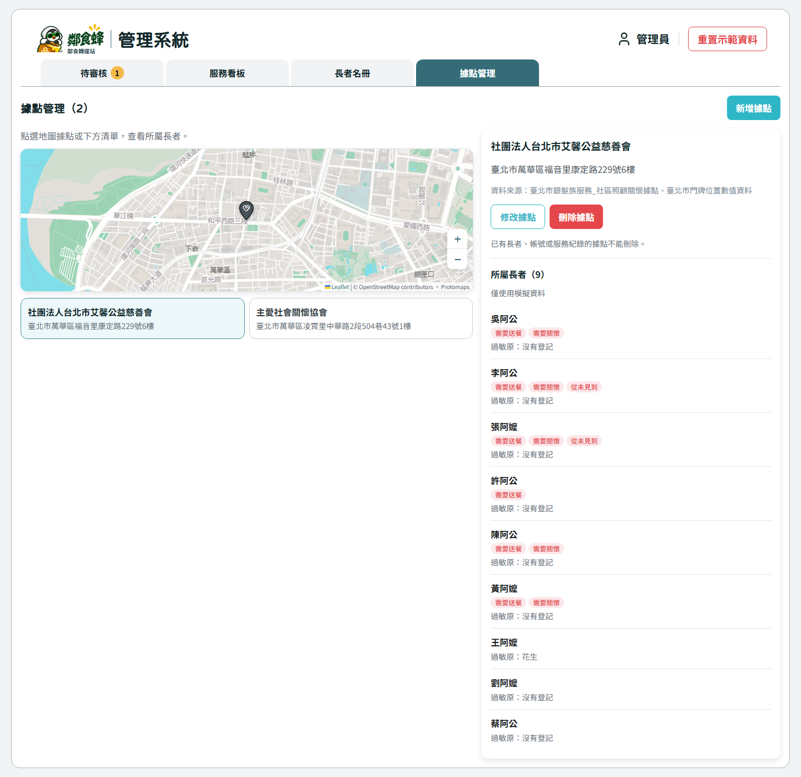
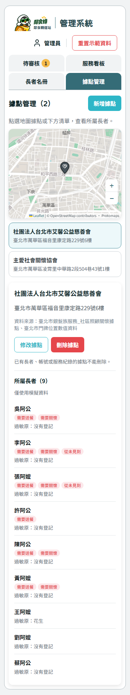
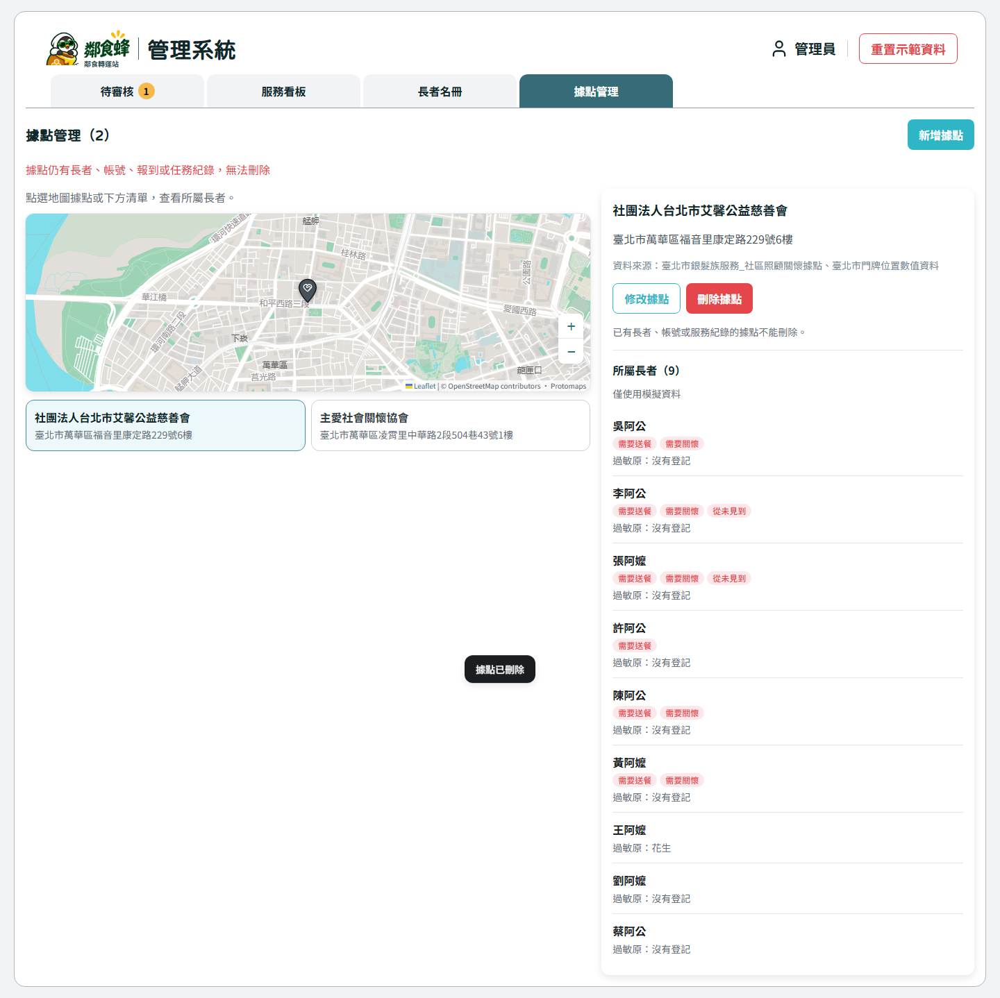
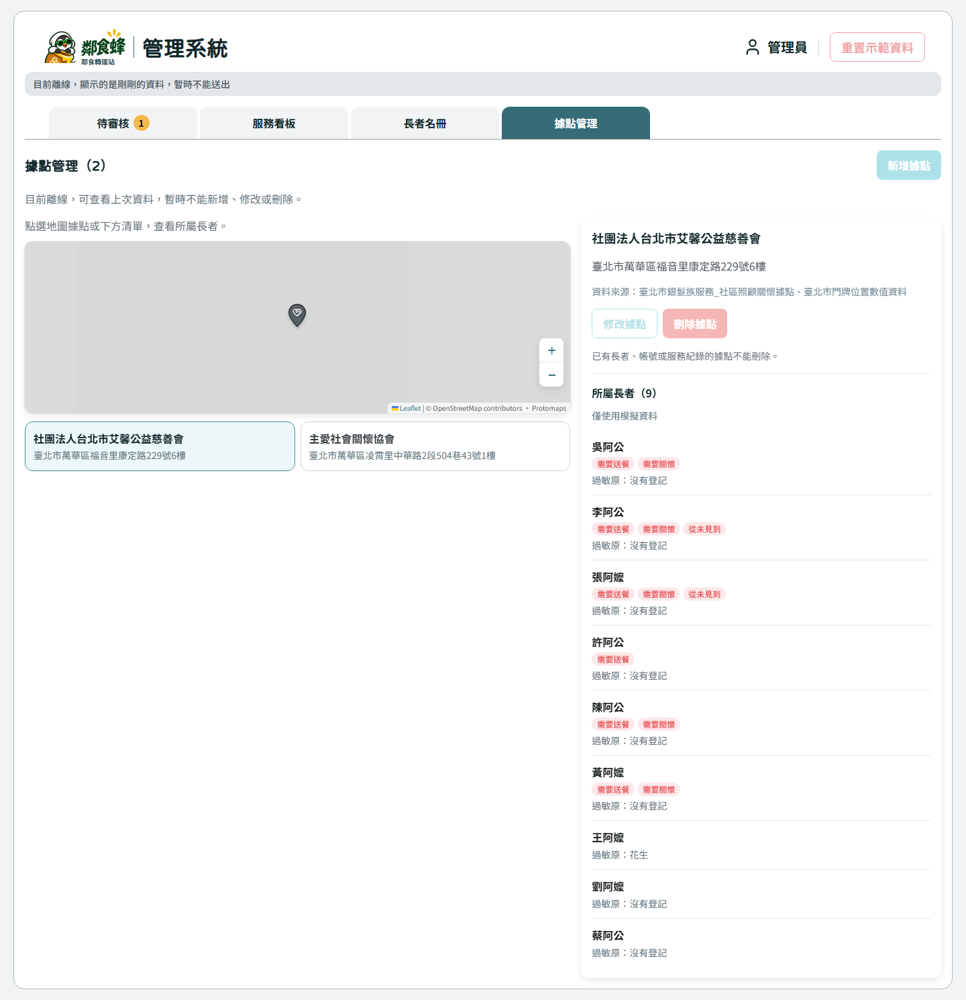

# T-140 據點地圖管理

工單 #115。使用者於2026-11-08要求在管理台「長者名冊」右側增加「據點管理」，地圖新增、修改、刪除據點，選取後顯示所屬長者。此要求授權新增下列 API；既有報到、長者與角色合約維持。

## API

全部以前綴 `/meal-relay`、`X-Demo-User` 識別，只有 admin 可以寫入。

| 方法 | 路徑 | 請求 | 回應 |
|---|---|---|---|
| POST | `/stations` | `{name, address?, location:{lat,lng}}` | Station |
| PATCH | `/stations/{id}` | 上述欄位選填 | Station |
| DELETE | `/stations/{id}` | 無 | 204，無內容 |

名稱去頭尾空白後1～100字，地址去空白後最多120字；位置沿用 Location 範圍。禁止未知欄位與顯式 null。新增 id 與 QR checkin_code 由伺服器產生，source 固定「管理員新增（模擬）」。修改保留 id/source/checkin_code，既有 QR 不失效。回應沿用 Station，不洩漏 checkin_code。

刪除前若任一長者（含已合併）、帳號、報到或派送任務仍引用該據點，回409 `STATION_IN_USE`，保留全部資料。不存在404 `NOT_FOUND`；非admin403 `FORBIDDEN_ROLE`；格式錯誤422 `VALIDATION_ERROR`。只刪除未使用的據點資料列，不更動資料庫結構。

## 畫面與流程

管理員第四分頁 `?tab=stations`，保留既有路由、歷史切換與角色保護。地圖與據點列表都能選據點，側欄只顯示該據點的長者（從admin既有長者名冊依station_id篩選）。長者名冊權限不擴大。

預設檢視模式，按「新增據點」後點地圖選位置、填名稱與地址；修改可在地圖重新選位置。點定位針只選據點，不意外改表單座標。刪除先確認，失敗顯示後端原因。離線或送出中停用寫入。成功後更新據點清單、名冊表單的據點選項與服務看板。

僅新增據點不會自動建立據點帳號或志工；帳號仍由既有種子匯入流程管理。既有食物點與據點沒有連動異動。

## 驗證

前後端測試涵蓋CRUD、欄位驗證、權限、刪除關聯防護與按據點篩長者；整合後主代理重跑arch、web build/test、backend ruff/pytest，並實際檢視畫面。驗證結果與未驗證項目見PR。

### 本輪結果

- 主代理親讀實作與測試diff並重跑：架構127元件／IDs、正式建置、前端22檔476測試、Ruff、後端284測試皆通過（既有Starlette/httpx棄用警告）。已同步主線食物種子照片更新。
- 真實HTTP12項通過：CRUD持久化、四角色403、引用刪除409、204空回應及QR識別不外洩。
- Playwright實際點擊12項通過：據點清單與定位針切換、所屬長者9／3位、地圖新增與修改座標、重載保留、刪除取消／確認及引用阻擋、離線寫入明確失敗且保留草稿、快取識別離線後停用寫入。
- 桌面1440px及手機375px無橫向溢出，沒有JavaScript未處理錯誤。主代理已直接讀取操作報告並檢視截圖。
- 驗收發現MapView選點動態class覆蓋Leaflet注入類別，已改掛外框並加入模式切換回歸測試；真實新增／修改操作已重新通過。
- Android：adb reverse成功，但自動核准審查拒絕啟動模擬器Chrome（僅回blocked by policy），因此裝置畫面尚未驗證；沒有重試或繞過。待整合者開啟裝置頁面驗收。不把375px瀏覽器測試等同裝置驗收。
- 本輪不合併、不部署。僅本機獨立資料庫與測試帳號，未改正式資料。

