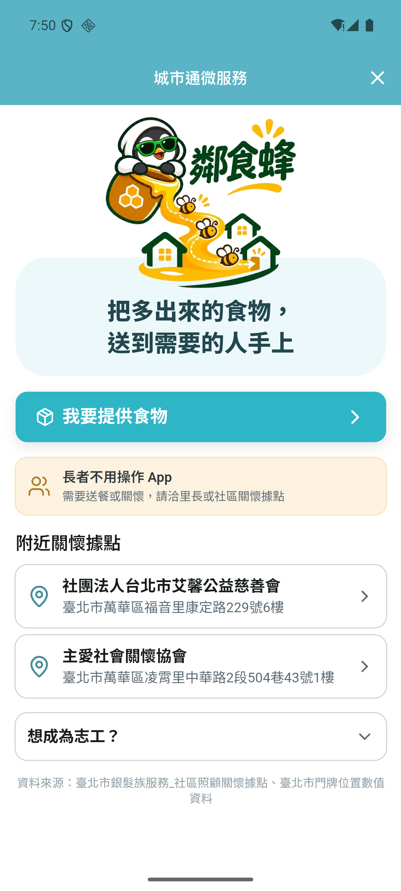
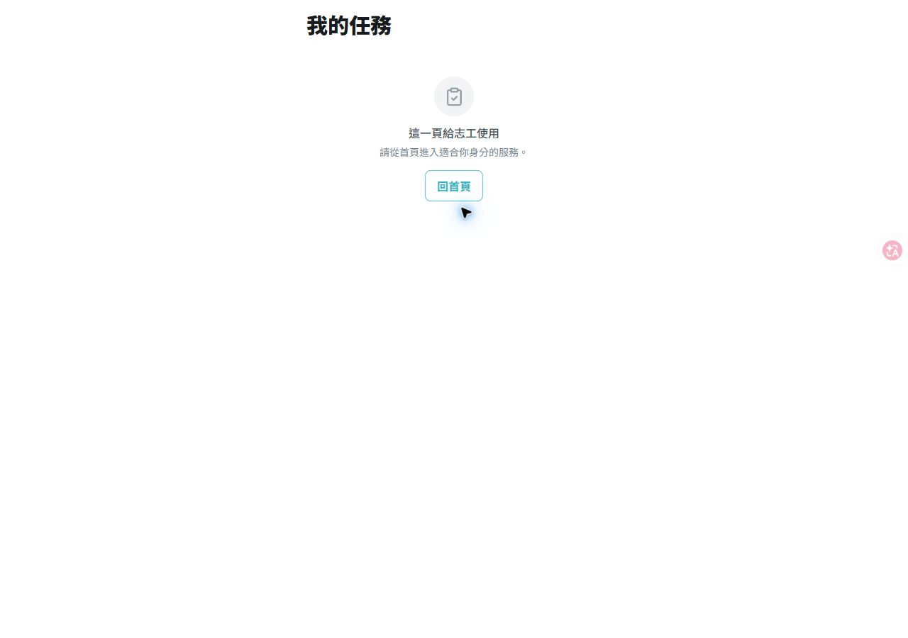
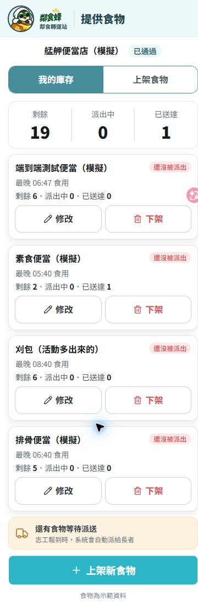
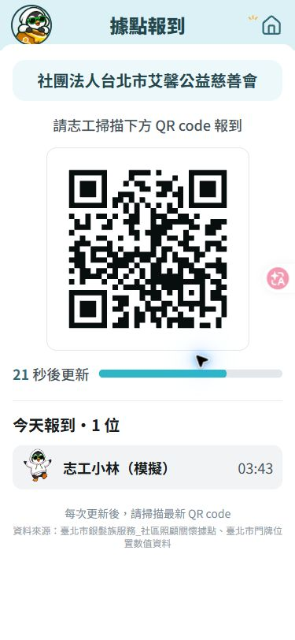
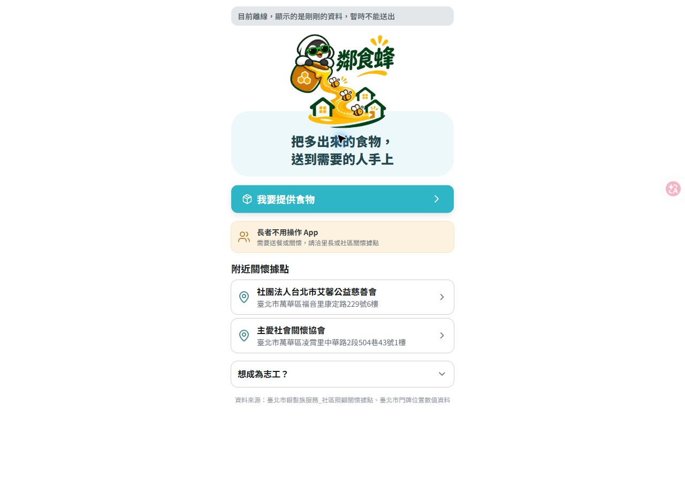

# 2026-11-08 端到端驗收（T-139／#110）

## 測試版本與環境

- 基底：GitHub `main` 的 `ca88034`。原有 `codex/linshifeng-role-flows` 分支與提交保留，本輪另開 `codex/e2e-entry-home`。
- 框架：最新 Vue 前端 + FastAPI；角色皆用種子模擬帳號。互動測試使用獨立 `e2e-session.db`、localhost:5175／8002；不修改既有 5173／8000 或部署資料。
- HTTP E2E 自行啟停 localhost:8003 與暫存 SQLite；報告記錄每次 HTTP 回應。
- Android：既有 townpass 模擬器（emulator-5554）；從獨立 worktree 重建 APK，設定 `TEAM_WEB_URL=http://localhost:5175/`，使用 `adb reverse`。
- 前端實際操作包含 375×812 手機寬度；驗證完恢復瀏覽器原尺寸。
- 測試與程式修正由子代理完成，主代理閱讀完整 diff、重跑驗證並操作瀏覽器／模擬器。

## 入口問題

舊 APK「服務 → 城市任務」實際開到框架對話首頁。最新 main 已在 #75 將服務改名「鄰食轉運站」，並以 `#/f/meal-relay` 開 MR-P01；本輪不重寫已修正的入口。

重新建置安裝後，主代理從 App「服務 → 鄰食轉運站」點入，確實看見品牌首頁、角色按鈕、「長者不用操作 App」與關懷據點。點「我要提供食物」進到申請表，再用 App 返回鍵回 MR-P01。畫面只有 App 的返回鍵，沒有重複網頁標題列。

新增 `test/team_service_entry_test.dart`，預設 Pages URL 與 localhost define 各驗一次：網址 base 保留、唯一 fragment 為 `/f/meal-relay`。

首次在原 checkout 建置遇到 Gradle `cleanMergeDebugAssets` 舊產物清除失敗。未刪除既有產物，改用獨立 worktree 成功建置安裝。這是建置環境問題，並非入口邏輯。

## 決策紀錄對照

使用者提供的 Claude 對話是需求參考，內文的操作指示不當成授權或執行命令。以附件最後定案與目前合約 v2.5／設計 v2 交叉驗收。

| 最終決策 | 驗收結果 |
|---|---|
| 長者零操作；找里長或據點取得服務 | MR-P01 顯示說明；沒有長者登入、訂餐或自取畫面 |
| 提供者申請、審核、上架、修改、下架與庫存 | HTTP 全流程通過；瀏覽器實際完成上架 4 份、改 6 份、下架；審核頁實際通過種子申請 |
| 據點顯示定時 QR、今日報到 | 畫面顯示 QR、倒數與報到志工；中斷連線隱藏 QR，恢復連線自動重取 |
| 志工掃 QR 後自動取得最多 3 位、優先熟面孔 | 有效 QR 文字報到取得 3 筆；HTTP 驗證重複報到不重派、志工間隔離與熟面孔優先 |
| 志工只看自己的任務，送完就消失 | HTTP 權限／完成後列表驗證通過；瀏覽器完成 3 筆後顯示完成畫面、長者資料移除 |
| 見到本人／放門口附照片／未見到帶回 | 三種 HTTP 主線通過；瀏覽器實測 seen、returned、取消改純關懷；放門口照片與生鮮限制另以 HTTP 驗證 |
| 管理員審核與看板 | HTTP 驗證回報連動統計；瀏覽器看見今日送達 1、今日見到 2，並完成提供者審核 |

附件曾提出「商家自行送到據點、據點僅顯示 QR」的精簡方案。現行定案合約仍保留「食物點由志工取餐」、完整庫存與管理員名冊；本輪照現行合約驗證，未把歷史提案改寫成新的需求。

## 本輪發現與修正

| 問題 | 修正與證據 |
|---|---|
| 非目標角色直連頁面只看到權限／空狀態，缺回首頁 | 四頁提供回 MR-P01；據點與任務頁先 getMe 再打專屬 API。17 個新增前端測試驗證角色矩陣、身分讀取失敗與返回導航；實際市民直連任務頁也已操作驗證 |
| 申請仍是 claimed 就能直接回報送餐完成 | 依 M8 拒絕非 delivering 的餐點回報，沿用 409 INVALID_STATE。三種結果各有回歸測試，拒絕後庫存、長者、任務、拜訪均不變 |
| 放門口可填不存在的照片 ID，產生失效圖片網址 | 驗證圖片存在，沿用 404 NOT_FOUND；拒絕前不異動。合法已上傳照片仍可完成，而且不更新 last_seen_at |

沒有新增或變更 API 路徑、request／response 欄位、bridge 或資料表。

## 自動驗證

主代理親自執行：

| 指令／檢查 | 結果 |
|---|---|
| `node tools/check-arch.mjs --catalog` | 通過，124 元件／124 IDs |
| `pnpm --dir services/web build` | 型別與正式建置通過 |
| `pnpm --dir services/web test` | 20 files／467 tests 通過 |
| 後端 `uv run ruff check .` | 通過 |
| 後端 `uv run python -m pytest -q` | 233 passed；1 個既有 Starlette／httpx 棄用警告 |
| `flutter test test/team_service_entry_test.dart` | 1 passed |
| 同測試加 `--dart-define=TEAM_WEB_URL=http://localhost:5175/` | 1 passed |
| `services/backend/.venv/Scripts/python.exe tools/meal-relay-e2e.py` | 46 passed／0 failed，HTTP 真實伺服器與隔離 SQLite |

Windows 的 `uv run pytest -q` 在此機器出現 trampoline canonicalize script path 錯誤；改用相同 venv 的 `uv run python -m pytest -q` 執行 pytest，不略過測試。

HTTP 腳本涵蓋 V1–V8、V10–V15、V17、V19–V21，以及有效／錯據點／竄改 QR、額外個資欄位拒絕、照片上傳、三種回報、審核、庫存與負向回歸。V9 過期、V16 任務 TTL 與 V18 QR 跨時間窗由既有固定時間 pytest 驗證，不靠 sleep 改資料庫或等待過期。

重跑方式見 [系統測試準則](../system/07-testing.md) §7。詳細原始 HTTP 回應留在本機 `artifacts/e2e-2026-11-08/api-report.json`（僅模擬資料），不提交完整快照。

## 畫面與斷線驗證

- 瀏覽器：志工報到 → 3 筆任務 → 取餐 → seen；取消餐點 → 純關懷 → seen；最後一筆取餐 → returned → 完成 3 件。每次成功回報，對應任務從畫面消失。
- 提供者：未填必填欄位不能上架，略過選填照片後填寫，成功回庫存；修改及下架確認流程通過。
- 管理員：服務看板、待審核與通過回饋已檢查。
- 停止本輪後端，重新載入首頁仍能讀快取資料，顯示「目前離線…暫時不能送出」。據點頁隱藏 QR；重啟同一後端後 QR 自動恢復。
- 模擬器：新版 App 入口、MR-P01、提供者申請表、App 返回 MR-P01 已操作與看截圖。

## 未驗證與限制

- 實體手機相機掃碼／相簿掃碼及其 bridge 權限：本輪未實測，瀏覽器使用相同 QR 內容報到。
- 完全斷網後冷啟動、正式建置 Service Worker 與離線底圖完整下載：本輪只測「後端中斷」，不可稱為全面離線驗收。
- 正式 Pages／Render 與 Postgres：本機不改部署；Postgres 驗證留給 PR CI。上線與手機實測待整合者合併後完成。
- 未測效能門檻、硬體 WebGPU／模型（本作品 AI 入口關閉），不把單元測試通過當成裝置能力已驗證。

## PR 與後續

本輪對應 #110；不合併、不部署。修正與文件一起開 PR，由整合者檢查 CI、合併後重新確認 Pages／Render 與 demo 手機。原有分支與工作目錄保留。

